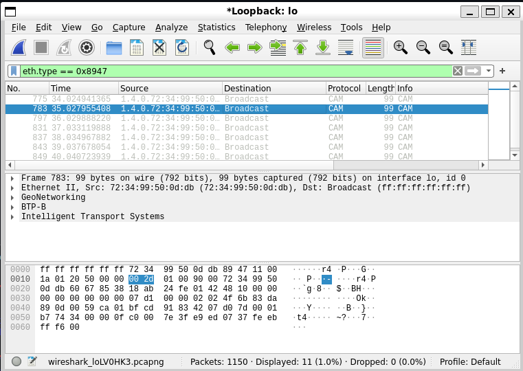
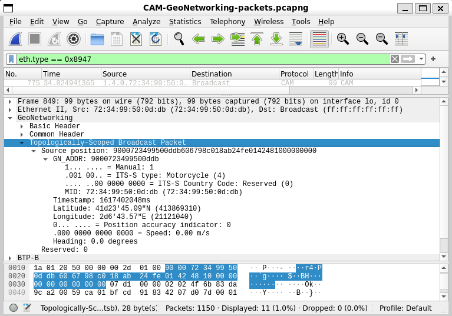

# GeoNetworking packet sniffing report

For simulation we run the standard CAM message simulation script provided in v2xflexstack documentation here: [https://flexstack.eu/modules/facilities/ca_basic_service.html#complete-example](https://flexstack.eu/modules/facilities/ca_basic_service.html#complete-example)

All the research is done inside wsl running on a Windows 11 machine

For packet sniffing we use **Windows Sub Linux Wireshark** (avalable in Windows 11)

With the following EtherType we can filter the packets that encapsulate **GeoNetwotking protocol**

```jsx
eth.type == 0x8947
```

Here we can see a payload simulation run on loopback address.



We observe the following:

- protocol type: GeoNetworking (recognised by wireshark)
- packet rate of 1000ms
- packet structure (as seen in the screenshot)

As described inside ETSI EN 302 636-4-1 V1.4.1 (2020-01):

> *9.3 GeoNetworking header structure The GeoNetworking header shall be comprised of a Basic Header, Common Header and an optional Extended Header (figure 5). Basic  Header Common Header Extended Header (optional) Figure 5: GeoNetworking header structure*
> 

We can observe the same packet structure on out sniffed packets:



In addition to the standard header structure we have a Topology-Scoped Brodcast Paket

This extended header contains information about:

- ITS-S type
- Timestamp
- Coordinates (latitude, longitude)
- speed / heading (relevant in a live cluster scenario)

This concludes our packet sniffing simulation using a working V2X CAM brodcast system in a controlled environment (loopback address), with a satisfactory result: **Full packet visibillity**

In the next papers we’ll focus on spoofing attack simulations and protocol-level security measures in order to combat this kind of attacks.